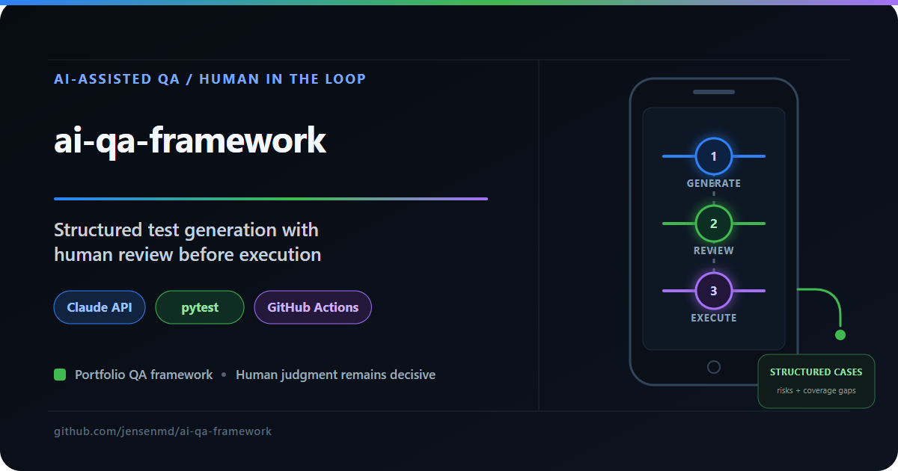
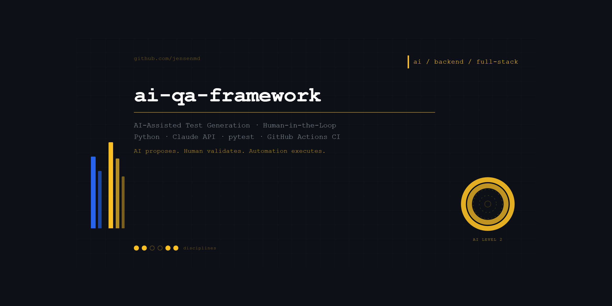

# ai-qa-framework



**AI-Assisted Test Case Generation & Execution Framework**

[](https://github.com/jensenmd/ai-qa-framework/actions/workflows/ci.yml)



---

## What This Is

A practical exploration of how AI can help develop API test coverage while a QA engineer owns the decisions. Claude proposes structured cases from an OpenAPI specification; human review shapes the coverage exercised by the pytest suite.

This project is built around a core principle:

> **AI proposes. Human validates. Automation executes.**

---

## The Problem This Solves

Manual test case generation is:

- Time-consuming and inconsistent across engineers
- Prone to missing edge cases and coverage gaps
- Difficult to keep current as APIs evolve
- Dependent on individual domain knowledge

AI-assisted generation gives the engineer a starting point to challenge: candidate cases, potential gaps, and proposed priorities. Their usefulness depends on review against the actual system and its risks.

---

## How It Works

```
OpenAPI Spec
     │
     ▼
┌─────────────────────────┐
│   Claude AI Analysis    │  ← Analyzes endpoints, methods,
│   (generate_tests.py)   │    data types, auth flows
└─────────────────────────┘
     │
     ▼
┌─────────────────────────┐
│   Structured Test Cases │  ← 10 test cases across 5 categories
│   + Coverage Gaps       │    Coverage gaps identified
│   + Risk Assessment     │    High-risk areas flagged
└─────────────────────────┘
     │
     ▼
┌─────────────────────────┐
│   HUMAN VALIDATION      │  ← QA engineer reviews AI output
│   (The Critical Step)   │    Applies domain knowledge
│                         │    Corrects, adds, removes
└─────────────────────────┘
     │
     ▼
┌─────────────────────────┐
│   pytest Execution      │  ← 16 tests executed against
│   (test_bookings.py)    │    live API
└─────────────────────────┘
     │
     ▼
┌─────────────────────────┐
│   GitHub Actions CI     │  ← Validates reviewed cases on every push
│   + HTML Test Report    │    Live AI generation is a manual review flow
└─────────────────────────┘
```

---

## Project Structure

```
ai-qa-framework/
├── specs/
│   └── restful-booker-openapi.json    # OpenAPI spec — input to AI
├── generator/
│   └── generate_tests.py              # Claude API integration
├── validation/
│   └── generated_test_cases.json      # AI output — human review layer
├── tests/
│   └── test_bookings.py               # pytest execution suite
├── reports/                           # CI-generated HTML test reports
└── .github/workflows/
    └── ci.yml                         # GitHub Actions pipeline
```

---

## What the AI Generates

For each API endpoint, Claude produces structured test cases covering:

| Category | Description |
|----------|-------------|
| `happy_path` | Valid inputs, expected successful responses |
| `negative` | Invalid inputs, error handling, rejection scenarios |
| `edge_case` | Boundary conditions, unusual but valid inputs |
| `auth` | Authentication flows, token validation, access controls |
| `data_validation` | Field types, required fields, data integrity |

Each test case includes:

- Endpoint and HTTP method
- Preconditions
- Input payload
- Expected status code
- Expected behavior description
- Risk level (high / medium / low)

Additionally, Claude identifies:

- **Coverage gaps** — areas the spec doesn't address
- **High-risk areas** — endpoints or behaviors warranting priority attention

---

## The Human-in-the-Loop Step

Human review connects generated suggestions to the actual system, its users, and its risks.

After generation, a QA engineer reviews `validation/generated_test_cases.json` and asks:

1. Are these test cases accurate for this specific system?
2. Are the edge cases realistic given what I know about the domain?
3. Are risk levels correctly assigned based on business impact?
4. What did AI miss that my domain knowledge would catch?
5. Are there compliance, regulatory, or security considerations AI didn't flag?

The generated cases are proposals. The QA engineer checks their accuracy, relevance, and priority before using them to guide coverage.

---

## Why This Matters

I've been doing enterprise QA for 15+ years — validating ETL pipelines, financial business logic, healthcare data integrity, and REST APIs across complex distributed systems. The judgment required for that work doesn't come from a tool. It comes from understanding why the numbers matter, where systems fail, and what questions to ask when something looks wrong.

I use AI to move from an initial idea to a reviewable set of cases, challenge gaps, and focus my attention on the areas where failures would matter most. I still own the decisions about what to test and what the results mean.

I was introduced to Ray Kurzweil's work on accelerating intelligence by a mentor in 2008. The integration of AI into knowledge work I watched coming for nearly two decades is here. This framework is how I'm applying it.

---

## Running Locally

**Prerequisites:**
- Python 3.11+
- Anthropic API key

**Setup:**
```bash
git clone https://github.com/jensenmd/ai-qa-framework
cd ai-qa-framework
pip install anthropic python-dotenv requests pytest pytest-html
```

**Create `.env` file:**
```
ANTHROPIC_API_KEY=your-key-here
```

**Generate test cases:**
```bash
python generator/generate_tests.py
```

**Review AI output:**
```
validation/generated_test_cases.json
```

**Execute tests:**
```bash
python -m pytest tests/test_bookings.py -v
```

---

## CI/CD Pipeline

GitHub Actions separates candidate generation from regression execution on pushes and pull requests to `main`:

1. Install dependencies
2. Check that the committed test-case artifact parses as JSON
3. Execute the implemented pytest regression suite against the live API
4. Upload the HTML test report as an artifact

Live Claude generation is available as a manually triggered workflow. It creates
candidate test cases and uploads them as an artifact for review; it does not
silently replace the reviewed cases during an ordinary push. The manual workflow
requires `ANTHROPIC_API_KEY` set as a GitHub Actions secret and accepts an optional
model ID, defaulting to `claude-haiku-4-5-20251001`.

---

The JSON artifact is not a general-purpose test executor. The Python suite implements specific API scenarios and checks the generated artifact; adding a generated case does not automatically create a new executable test. Human review includes deciding which cases to implement.

## Recorded Test Result

The following result is retained from the existing README; it was not rerun during this documentation review and has no recorded run date here.

```
16 passed in 8.84s
```

| Test Class | Tests | Status |
|------------|-------|--------|
| TestHealthCheck | 1 | ✅ |
| TestAuthentication | 3 | ✅ |
| TestGetBookings | 5 | ✅ |
| TestCreateBooking | 4 | ✅ |
| TestAICoverageGaps | 3 | ✅ |

---

## QA Portfolio Quick Reference

See [Michael D. Jensen’s QA portfolio](https://github.com/jensenmd) for the complete project overview.

| Project | Purpose and Approach |
| --- | --- |
| [fhir-api-qa](https://github.com/jensenmd/fhir-api-qa) | Checks whether a healthcare API preserves Patient data through its lifecycle, with isolated FHIR tests and useful CI failure evidence. |
| [pharmacy-spend-etl-qa](https://github.com/jensenmd/pharmacy-spend-etl-qa) | Checks that pharmacy spend data survives the trip from source files to analytics tables, using SQL reconciliation on a synthetic pipeline. |
| [restful-booker-qa](https://github.com/jensenmd/restful-booker-qa) | Tests booking behavior at both API and browser layers, combining Postman/Newman and Playwright for repeatable regression feedback. |
| [qa-automation-showcase](https://github.com/jensenmd/qa-automation-showcase) | Examines API behavior and the quality of returned data together, using pytest, Postman, and Python validation. |
| [android-appium-wdio-poc](https://github.com/jensenmd/android-appium-wdio-poc) | Builds a focused baseline for Android UI checks, exercising Settings navigation on a local emulator with Appium and WebdriverIO. |
| [mapmyrun-quality-investigation](https://github.com/jensenmd/mapmyrun-quality-investigation) | Investigates how workout tracking affects data integrity and user trust, using mobile field experiments and separating observations from explanations. |
| [ai-qa-framework](https://github.com/jensenmd/ai-qa-framework) **(this repository)** | Explores how AI can help develop useful API test coverage while keeping a QA engineer responsible for review and pytest execution. |
| [claude-code-qa-sessions](https://github.com/jensenmd/claude-code-qa-sessions) | Shows how human QA judgment guides Claude Code from finding coverage gaps to making targeted, reviewed test improvements. |
| [agentqa-orchestrator](https://github.com/jensenmd/agentqa-orchestrator) | Explores inspectable AI code reviews, using Gemini and Pydantic-defined response schemas to produce structured JSON audit artifacts. |

---

## Author

**Michael D. Jensen** — Senior QA Engineer
[LinkedIn](https://linkedin.com/in/michaeljensen-qa) · [GitHub](https://github.com/jensenmd/)
